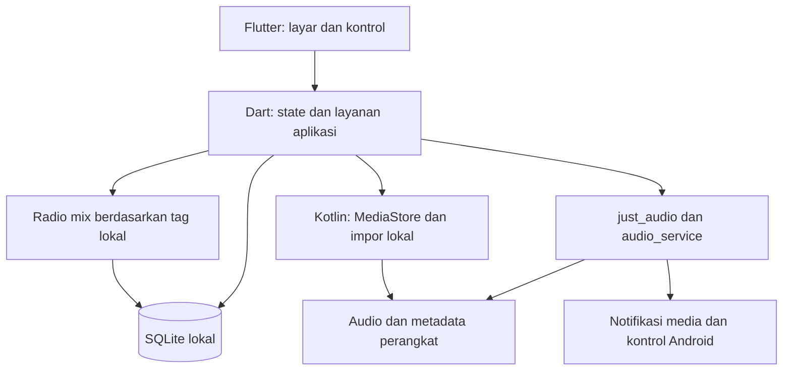

# Rencana implementasi Spomaxxing

## 1. Tujuan dan keputusan pengguna

Membangun aplikasi musik Android yang sepenuhnya offline dengan Flutter/Dart untuk antarmuka dan logika aplikasi, serta Kotlin untuk integrasi Android. Pengalaman koleksi, pemutar, pencarian, dan radio mengambil inspirasi dari pemutar musik Spotify, dengan nama dan aset Spomaxxing sendiri.

Keputusan yang telah dipilih pengguna:

| Bagian | Keputusan |
| --- | --- |
| Platform pertama | Android |
| Sumber audio | Berkas audio di perangkat pengguna |
| Pencarian suasana | Kata kunci dan tag lokal |
| Tampilan | Palet hijau dan hitam |
| Penyimpanan hasil pekerjaan | Commit dan push ke GitHub |

Dokumen ini adalah tahap perencanaan. Implementasi aplikasi dilanjutkan setelah pengguna meninjau rencana dan meminta pelaksanaannya.

## 2. Kontrak offline

- Pemasangan APK dan penyediaan berkas audio dilakukan terlebih dahulu. Setelah itu, fitur aplikasi berjalan dalam mode pesawat sejak peluncuran pertama.
- APK rilis tidak memiliki izin `android.permission.INTERNET`; manifest hasil penggabungan dependensi diperiksa pada build rilis.
- Audio, metadata, sampul, daftar putar, tag suasana, riwayat, serta antrean pemutaran disimpan atau dibaca secara lokal.
- Aplikasi tidak membutuhkan akun, API Spotify, server, streaming, analitik, iklan, font daring, atau pengunduhan sampul.
- "Semua lagu" mencakup seluruh koleksi audio lokal yang dapat diakses dan didukung perangkat. Lagu yang belum tersedia sebagai berkas lokal tidak muncul sebagai audio yang bisa diputar.
- Tautan playlist Spotify yang diberikan pengguna menjadi referensi konsep radio mix. Versi pertama tidak mengimpor isi tautan tersebut atau menganggap audio playlist tersedia secara lokal.
- Audio berproteksi DRM atau cache unduhan aplikasi lain tidak diasumsikan sebagai berkas yang bisa diputar. Pengguna memasukkan berkas yang berhak mereka gunakan.
- Internet boleh digunakan oleh mesin pengembangan untuk memasang Flutter, Android SDK, dan dependensi. Persyaratan offline berlaku pada aplikasi yang terpasang.

## 3. Fitur versi pertama

### Koleksi musik

- Pindai musik melalui Android MediaStore dengan izin yang sesuai versi Android.
- Sediakan impor melalui pemilih berkas sistem untuk berkas lokal yang belum masuk MediaStore.
- Tampilkan judul, artis, album, durasi, genre jika tersedia, dan sampul tertanam; gunakan nama berkas atau gambar bawaan untuk metadata yang kosong.
- Cari judul, artis, dan album tanpa jaringan. Tampilkan lagu, album, artis, favorit, dan playlist lokal.
- Pindai ulang secara bertahap dan tangani berkas yang dihapus, dipindahkan, atau tidak lagi dapat diakses.
- Format awal yang divalidasi: MP3, AAC/M4A tanpa DRM, FLAC, WAV, dan Ogg Vorbis. Dukungan akhir mengikuti codec dan kemampuan Android yang diuji; berkas rusak/unsupported memiliki pesan yang jelas.

### Pemutar

- Putar/jeda, seek, sebelumnya/berikutnya, pengaturan antrean, dan perpindahan otomatis saat lagu selesai.
- Shuffle mengacak sisa antrean sambil mempertahankan lagu yang sedang diputar. Riwayat sebelumnya tetap mengikuti lagu yang benar-benar diputar.
- Repeat menyediakan mati, satu lagu, dan seluruh antrean. Dengan repeat mati, pemutaran berhenti setelah antrean habis; pengguna dapat mengaktifkan repeat antrean untuk radio berulang.
- Pemutaran berjalan saat layar mati atau aplikasi berada di latar belakang, dengan notifikasi media, kontrol lock screen, dan kontrol headset.
- Tangani audio focus, panggilan, dan headset terlepas; resume hanya sesuai status pemutaran sebelum interupsi.
- Simpan antrean dan posisi untuk pemulihan setelah aplikasi dibuka kembali. Pemutaran tidak dimulai sendiri setelah force-stop atau reboot.

### Pencarian suasana dan radio mix

- Kosakata awal: santai, fokus, sedih, semangat, bahagia, dan tidur; alias seperti tenang/chill dipetakan ke tag yang relevan.
- Pengguna dapat memberi beberapa tag pada sebuah lagu dan melakukan pemberian tag secara massal. Genre yang tersedia boleh menawarkan saran tag yang harus dikonfirmasi pengguna.
- Radio mix menggunakan lagu bertag yang cocok dari koleksi lokal. Metadata judul/artis saja tidak dianggap bukti suasana.
- Pengguna dapat memulai radio dari suasana atau dari sebuah lagu yang memiliki tag. Lagu awal masuk di posisi pertama untuk radio dari lagu.
- Kandidat diurutkan menurut kecocokan tag utama dan tag tambahan, lalu diacak dengan variasi artis jika koleksi memungkinkan.
- Target awal satu mix adalah 25 lagu unik atau seluruh kandidat jika jumlahnya lebih sedikit. Tidak ada lagu berulang sebelum semua kandidat selesai, kecuali repeat satu lagu dipilih.
- Jika kandidat kosong, tampilkan ajakan memberi tag atau menambahkan berkas. Jika kandidat sedikit, jelaskan jumlah yang tersedia; jangan menjanjikan lagu tambahan dari internet.
- Setiap hasil dapat menjelaskan kecocokannya, misalnya "Tag: fokus". Pengguna dapat menyimpan mix sebagai playlist lokal dan membuat mix baru dengan variasi urutan.

## 4. Tampilan

| Layar | Isi utama |
| --- | --- |
| Beranda | Suasana, terakhir diputar, favorit, dan mix tersimpan |
| Cari | Pencarian lokal dengan hasil lagu/artis/album dan pintasan suasana |
| Koleksi | Lagu, album, artis, playlist, impor, dan status pemindaian |
| Radio mix | Suasana atau lagu awal, alasan kecocokan, jumlah lagu, dan tombol putar/shuffle |
| Sedang diputar | Sampul, judul/artis, progres, kontrol, favorit, repeat, dan shuffle |
| Antrean | Lagu saat ini, urutan berikutnya, hapus, dan susun ulang |
| Editor tag | Tag suasana per lagu dan pemberian tag massal |
| Pengaturan | Izin audio, lokasi impor, pindai ulang, dan informasi penyimpanan |

Palet awal: latar `#121212`, permukaan `#1E1E1E`, aksen hijau `#1DB954`, teks utama `#FFFFFF`, dan teks sekunder `#B3B3B3`. Gunakan warna teks tombol yang memenuhi kontras, ikon/aset milik sendiri, ukuran sentuh yang memadai, label pembaca layar, dan tata letak yang mengikuti ukuran teks Android.

## 5. Arsitektur yang direncanakan



- Flutter/Dart: UI, state, pencarian, aturan antrean, radio mix, dan validasi data.
- Kotlin melalui platform channel: query MediaStore, akses URI, impor melalui pemilih berkas sistem, dan perubahan koleksi Android. Pemutaran tidak dibuat ulang dalam Kotlin jika paket pemutar sudah memenuhi kebutuhan.
- Kandidat dependensi: Riverpod untuk state, Drift/SQLite untuk data lokal, just_audio untuk pemutaran, serta audio_service/audio_session untuk layanan media dan audio focus. Versi dan lisensi diperiksa saat tahap fondasi; lockfile aplikasi dikomit agar build dapat diulang.
- Gunakan satu pengelola antrean sebagai sumber kebenaran. Event selesai, tombol next, dan event error ditangani berurutan agar tidak melewati dua lagu karena event ganda.
- Database menyimpan identitas lagu lokal, referensi audio, metadata, tag, playlist, favorit, dan riwayat/posisi pemutaran. Antrean serta urutan shuffle dapat dipulihkan.
- Identitas lagu memakai volume/ID MediaStore atau ID impor; lagu berbeda tidak digabung hanya karena judulnya sama. Pindai ulang mempertahankan tag dan favorit selama identitasnya tetap dapat dikenali.
- Query metadata, pembuatan thumbnail, dan pekerjaan database yang berat berjalan di luar jalur rendering. Daftar besar dimuat bertahap.

Struktur yang akan dibuat:

```text
lib/
  app/
  core/
  data/
  features/library/
  features/search/
  features/player/
  features/radio/
  features/playlists/
  features/settings/
android/app/src/main/kotlin/.../
test/
integration_test/
```

## 6. Akses berkas dan kompatibilitas Android

- Tentukan Flutter stabil, Dart bawaannya, JDK, Gradle, Android Gradle Plugin, dan Kotlin yang saling kompatibel sebelum scaffold. Catat versi persis; jangan mencampur versi terbaru secara acak.
- Tentukan minSdk setelah menguji persyaratan paket, dengan Android 8/API 26 sebagai kandidat awal; targetSdk mengikuti persyaratan distribusi saat implementasi.
- Gunakan `READ_MEDIA_AUDIO` pada Android 13+ dan izin yang sesuai pada Android lama, dengan penanganan penolakan izin. Hindari izin akses semua berkas.
- Impor menyalin berkas yang dipilih ke penyimpanan privat aplikasi agar tetap tersedia setelah restart dan tetap lokal. Jelaskan pemakaian ruang dan tangani pembatalan/ruang penuh. Berkas dari provider cloud harus tersedia lokal terlebih dahulu.
- Akses MediaStore menggunakan URI, tanpa mengandalkan path mentah yang tidak selalu tersedia pada scoped storage. Pencabutan izin menampilkan langkah pemulihan yang jelas.
- Buktikan playback URI MediaStore, MP3/FLAC sampel, layanan foreground media, notifikasi, dan audio focus dalam percobaan teknis sebelum memperluas UI.
- Periksa izin foreground service/media playback dan konfigurasi layanan sesuai targetSdk, termasuk perilaku notifikasi pada Android terbaru.
- Tidak ada layanan yang diasumsikan tetap hidup setelah proses dihentikan. Startup memulihkan data tersimpan dan memeriksa akses berkas.

## 7. Urutan implementasi dan hasil tiap tahap

| Tahap | Pekerjaan | Syarat selesai |
| --- | --- | --- |
| 1. Fondasi dan percobaan teknis | Siapkan toolchain, scaffold Flutter/Kotlin, kunci dependensi, buktikan akses audio dan playback background, periksa manifest rilis | Build APK debug/rilis berhasil; audio lokal dapat diputar dan dikontrol dari notifikasi |
| 2. Koleksi lokal | MediaStore, impor privat, metadata/sampul, database, pencarian, izin dan error | Koleksi tetap dapat dicari setelah restart dalam mode pesawat; berkas hilang dan izin ditolak ditangani |
| 3. Pemutar lengkap | Antrean, auto-next, shuffle, repeat, seek, audio focus, pemulihan posisi | Uji aturan antrean lulus dan playback layar mati berjalan pada perangkat Android |
| 4. Radio suasana | Editor tag, alias suasana, pencocokan, variasi mix, radio dari lagu, simpan playlist | Hasil radio berasal dari tag yang sesuai dan semua URI mengarah ke audio lokal |
| 5. UI dan ketahanan | Semua layar, tema, aksesibilitas, koleksi besar, ruang penuh, codec rusak, interupsi | Alur utama dapat diselesaikan tanpa jaringan dan kegagalan tidak menyebabkan crash |
| 6. Validasi dan dokumentasi | Pengujian rilis, dokumentasi build/penggunaan, catatan batasan, commit dan push | APK dan instruksi dapat direproduksi; hasil uji tercatat dan status GitHub terverifikasi |

Setiap tahap menghasilkan perubahan yang dapat ditinjau dan commit yang jelas. Dorong pekerjaan ke GitHub sesuai instruksi pengguna, tanpa menyertakan rahasia, signing key, audio pribadi, atau berkas build besar ke source repository. Kebutuhan review rencana tidak menggantikan instruksi push dokumentasi ini.

## 8. Pengujian yang membuktikan aplikasi offline

- Unit: alias suasana, kandidat radio, koleksi kosong/kecil, variasi artis, shuffle tanpa pengulangan dalam satu putaran, repeat, dan event next/selesai yang berdekatan.
- Database: migrasi, simpan/pulihkan playlist dan tag, rescan, serta pemulihan antrean setelah proses dimulai kembali.
- Widget: pencarian, empty state, penolakan izin, editor tag, dan kontrol pemutar.
- Integrasi Android: MediaStore URI, impor, berkas hilang/rusak, MP3/FLAC dan format lain yang dinyatakan didukung, layar mati, notifikasi, headset terlepas, serta audio focus.
- Rilis: `flutter analyze`, `flutter test`, build APK, dan pemeriksaan merged manifest/APK untuk memastikan tidak ada izin internet.
- Uji fungsional perangkat: pasang APK rilis, aktifkan mode pesawat sebelum peluncuran pertama, pindai/impor audio lokal, cari suasana, mainkan mix, tunggu lagu selesai, aktifkan shuffle, dan buka kembali aplikasi untuk memeriksa pemulihan koleksi.
- Gunakan audio uji buatan sendiri atau berlisensi jelas; catat asal/lisensi fixture. Jangan memasukkan koleksi pribadi pengguna ke GitHub.
- Uji minimal perangkat/emulator API lama yang didukung dan Android terbaru. Pengujian perangkat nyata diperlukan untuk kontrol media dan perilaku latar belakang; hasil cloud saja tidak membuktikan semua perilaku perangkat.

## 9. Risiko dan pengembangan berikutnya

| Risiko | Penanganan |
| --- | --- |
| Banyak lagu belum memiliki tag | Editor tag massal dan saran yang dapat dikonfirmasi; hasil kosong dijelaskan |
| Metadata salah atau tidak lengkap | Fallback nama berkas; tag manual diprioritaskan |
| Penyimpanan terbatas | Periksa ruang saat impor, jelaskan ukuran koleksi, dan batalkan impor dengan aman |
| Format/codec berbeda antarperangkat | Tetapkan daftar dukungan berdasarkan uji dan tampilkan error per lagu |
| Pembatasan background Android/vendor | Gunakan layanan media resmi dan uji layar mati/interupsi pada perangkat nyata |
| Koleksi ribuan lagu | Indeks/query bertahap, thumbnail terbatas, dan uji dataset besar |

Sesudah versi pertama stabil, fitur opsional dapat mencakup klasifikasi suasana dari audio dengan model yang berjalan di perangkat, pencarian kalimat bebas lokal, equalizer, crossfade, lirik dari berkas lokal, dan desktop. Model suasana perlu evaluasi akurasi, ukuran, lisensi, dan konsumsi daya tersendiri; fitur ini belum menjadi syarat versi pertama.

## 10. Status pemeriksaan saat menyusun rencana

- Checkout `sagara-ds/spomaxxing` awalnya kosong dan tidak memiliki commit atau branch remote.
- Akses baca GitHub melalui konfigurasi lingkungan tersedia.
- Flutter, Dart, Kotlin CLI, dan Android Debug Bridge belum ditemukan pada PATH saat pemeriksaan; Java tersedia. Instalasi dan kompatibilitas toolchain menjadi pekerjaan tahap 1.
- Belum ada kode aplikasi, pengujian runtime, atau APK. Diagram dan pilihan dependensi di atas adalah rencana yang perlu dibuktikan pada tahap implementasi.
