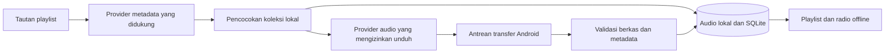

# Usulan impor playlist dan unduhan untuk Spomaxxing

## Tujuan

Pengguna menempel tautan playlist atau radio, aplikasi memperoleh daftar lagu yang dapat diakses, lalu audio yang tersedia dari sumber yang mengizinkan pengunduhan disimpan ke koleksi Spomaxxing. Setelah impor selesai, playlist dan lagu dapat diputar tanpa jaringan.

Status: pengguna memilih impor dan unduh langsung di Android, dengan internet saat dibutuhkan dan alert saat mencoba mengunduh tanpa koneksi. [Rencana utama](PLAN.md) sudah mengikuti keputusan ini. Belum ada downloader, integrasi API, atau audio yang diunduh.

## Batas teknis yang perlu dipahami

- Memperoleh isi tautan dan mengunduh berkas membutuhkan internet. Yang dapat dijamin offline setelah impor adalah koleksi, pencarian lokal, radio lokal, dan playback.
- Tautan Spotify mengidentifikasi playlist; tautan itu tidak menyediakan berkas audio yang dapat diunduh oleh aplikasi umum.
- README `spotify-dl` milik SathyaBhat menjelaskan bahwa alatnya mengambil metadata Spotify, kemudian menggunakan `yt-dlp` untuk memperoleh audio dari sumber lain. README spotDL juga menjelaskan pencarian audio melalui YouTube.
- Hasil pencocokan sumber lain dapat berbeda versi, misalnya live, cover, remix, clean, atau rekaman dengan durasi berbeda. Metadata Spotify tidak membuktikan identitas ataupun izin unduh suatu berkas.
- Tools berbasis Python, `yt-dlp`, dan FFmpeg bukan plugin Flutter yang tinggal dipasang. Membundelnya pada Android memerlukan pengujian kompatibilitas, ukuran paket, lisensi, pembaruan extractor, serta perilaku background tersendiri.
- Isi playlist privat, radio yang dipersonalisasi, dan playlist milik platform mungkin tidak tersedia melalui akses API yang diberikan kepada aplikasi. Dukungan tiap jenis tautan perlu dibuktikan melalui API resmi; tidak ada janji bahwa setiap tautan Spotify dapat diimpor.
- Pengunduhan mengikuti izin sumber audio dan ketentuan layanan yang digunakan. Tidak direncanakan ekstraksi cache Spotify, pembukaan DRM, atau akses dengan mengambil kredensial aplikasi lain.

## Keputusan produk dan alternatif

| Bagian | Unduh langsung di Android | Alat pendamping di komputer |
| --- | --- | --- |
| Tempel tautan | Di Spomaxxing | Di alat pendamping |
| Kebutuhan internet | Android saat impor | Komputer saat menyiapkan paket |
| Izin internet APK | Diperlukan | Tetap dapat dihilangkan |
| Audio tersedia di aplikasi | Setelah unduh selesai | Setelah paket dipindah dan diimpor |
| Kerumitan | Integrasi API, transfer background, auth, ruang penyimpanan | Transfer paket dan importer lokal; tool komputer terpisah |
| Kontrak offline | Playback dan koleksi offline setelah impor | Aplikasi Android sepenuhnya offline |

Opsi Android telah dipilih dan merevisi aturan sebelumnya bahwa APK rilis tidak memiliki izin `INTERNET`. Pemutar dan pencarian koleksi lokal tidak melakukan permintaan jaringan saat beroperasi offline. Companion dicatat sebagai alternatif pengembangan berikutnya, bukan syarat penggunaan aplikasi.

Jumlah data unduhan mengikuti jumlah lagu, ukuran audio, dan sampul yang diambil. Tampilkan estimasi bila sumber menyediakan ukuran berkas; jangan menjanjikan seluruh playlist hanya membutuhkan sedikit data.

## Alert dan perilaku saat tidak ada internet

- Periksa koneksi ketika pengguna menekan impor/unduh; jangan memeriksa jaringan berkala saat pengguna hanya memutar audio lokal.
- Jika tidak ada koneksi, tampilkan: **"Tidak ada koneksi internet. Hubungkan ke internet untuk mengunduh lagu. Lagu yang sudah tersimpan tetap bisa diputar."** Sediakan tombol **Tutup** dan **Coba lagi**.
- Wi-Fi aktif belum membuktikan layanan dapat diakses. Tangani kegagalan permintaan yang sebenarnya; masalah autentikasi, playlist tidak diizinkan, atau sumber tidak tersedia memiliki pesan berbeda dari tidak ada internet.
- Jika koneksi putus saat mengunduh, tandai pekerjaan **Dijeda — menunggu koneksi**, pertahankan progres yang valid, dan gunakan satu pemberitahuan untuk batch tersebut. Playback audio yang sudah tersimpan tetap berjalan.
- Pengguna dapat melanjutkan atau membatalkan unduhan. Pemulihan proses tidak otomatis menjalankan permintaan yang tidak terkait antrean impor yang dipilih pengguna.
- Badge **Tersedia offline** diberikan hanya setelah berkas lengkap berhasil divalidasi. Untuk playlist parsial, tampilkan jumlah yang sudah lokal, misalnya **12 dari 20 lagu tersedia offline**.

## Alur yang diinginkan

1. Pengguna menempel tautan; aplikasi memvalidasi host, jenis tautan, dan identitas playlist. Parameter berbagi tidak diperlakukan sebagai kredensial.
2. Provider metadata mengambil nama playlist dan daftar lagu melalui akses yang didukung, atau pengguna menyediakan manifest daftar lagu sebagai alternatif.
3. Aplikasi mencocokkan lagu dengan koleksi lokal terlebih dahulu, menggunakan ID/rekaman yang diketahui, judul, artis, dan durasi. Kecocokan meragukan ditampilkan untuk konfirmasi.
4. Lagu yang belum ada dicocokkan dengan sumber audio yang mengizinkan unduh. Sumber tidak didukung atau lagu tidak tersedia ditandai sebagai gagal/menunggu, bukan diganti diam-diam.
5. Unduhan yang memenuhi persyaratan dapat langsung masuk antrean. Pencocokan alternatif yang ambigu memerlukan pilihan pengguna.
6. Tampilkan kemajuan per lagu dan playlist: sudah lokal, menunggu, mengunduh, memverifikasi, selesai, gagal, atau dibatalkan.
7. Setelah sebuah berkas selesai dan dapat dibaca pemutar, masukkan ke database dan playlist lokal secara atomik. Playlist mempertahankan urutan asal dan status lagu yang belum berhasil.
8. Playlist langsung muncul di Koleksi. Lagu yang selesai dapat diputar selama lagu lain masih diproses; status "tersedia offline" hanya berlaku bagi audio yang sudah tersimpan.
9. Playlist disimpan sebagai snapshot. Jika radio atau playlist asal berubah, pengguna dapat memperbaruinya secara eksplisit saat online; snapshot lokal tetap bisa diputar offline.

## Arsitektur Android yang direncanakan

- Flutter/Dart: formulir tempel tautan, pratinjau daftar lagu, pemilihan kandidat jika ambigu, status unduhan, dan pemutaran lokal.
- Kotlin: transfer yang sesuai kemampuan Android/targetSdk, notifikasi progres, pembatalan, dan pengelolaan berkas. Evaluasi WorkManager atau mekanisme transfer yang didukung setelah menguji batas foreground service dan pekerjaan panjang pada Android terbaru.
- Pisahkan `PlaylistMetadataProvider` dari `AuthorizedAudioProvider`. Downloader tidak diasumsikan bisa memperoleh audio hanya karena judul tersedia di Spotify.
- Bila API metadata menggunakan autentikasi pengguna, gunakan alur public-client yang didukung, seperti OAuth PKCE jika tersedia. Jangan menaruh client secret di APK; kebutuhan backend ditentukan oleh operasi yang benar-benar harus digunakan.
- Gunakan koneksi TLS yang diverifikasi. Jangan mematikan pemeriksaan sertifikat untuk membuat extractor bekerja.
- Simpan progres pekerjaan secara lokal dan pulihkan status sesudah proses dihentikan. Resume byte hanya dipakai bila server mendukungnya dan identitas berkas tetap cocok; selebihnya ulangi transfer secara aman.
- Berkas sementara tidak dianggap lagu selesai. Periksa status HTTP, ukuran maksimum, tipe konten, dan apakah decoder dapat membaca audio sebelum publikasi ke koleksi. Verifikasi checksum tepercaya jika penyedia menerbitkannya.
- Tangani ruang penuh, pembatalan, koneksi putus, URL kedaluwarsa, rate limit, dan sumber hilang; batasi concurrency dan retry agar perangkat tetap responsif.
- Simpan provenance sumber dan atribusi yang diwajibkan. Jangan mengklaim codec/bitrate hasil konversi sebagai kualitas asli Spotify.
- Verifikasi ketentuan penggunaan, penyimpanan, dan atribusi metadata/sampul secara terpisah dari izin pengunduhan audio. Jika provider membatasi penyimpanan, gunakan metadata lokal yang diizinkan dan fallback sampul bawaan.

## Alternatif lanjutan: paket companion

Paket berisi manifest playlist, metadata lokal, dan audio yang pengguna berhak gunakan. Importer Android memeriksa versi manifest, referensi berkas, duplikasi, dan ruang kosong, lalu menyalin audio ke penyimpanan privat aplikasi.

Manifest menggunakan ID internal, urutan lagu, judul, artis, durasi, path relatif berkas, serta provenance/lisensi jika relevan. URL playlist dapat menjadi referensi asal metadata. URL tersebut tidak diperlukan saat playback.

Jika memakai arsip, importer membatasi ukuran/jumlah berkas serta menolak path absolut dan path yang keluar dari direktori impor. Paket rusak atau impor parsial tidak mengubah playlist yang sudah ada.

## Hubungan dengan radio suasana

- Playlist yang diimpor muncul sebagai playlist lokal, termasuk nama dan urutan yang tersedia.
- Nama playlist tidak otomatis menjadi tag suasana untuk semua lagu. Pengguna dapat mengonfirmasi tag suasana secara massal pada layar impor.
- Radio suasana menggunakan lagu yang selesai diimpor dan memiliki tag yang sesuai. Lagu yang belum diunduh tidak dimasukkan ke antrean offline.
- Mix baru dibuat dari koleksi lokal; perubahan radio Spotify tidak tersinkron otomatis saat perangkat offline.

## Validasi sebelum fitur dinyatakan didukung

1. Buktikan akses metadata playlist contoh melalui konfigurasi resmi yang tersedia. Bedakan playlist berhasil, privat/tidak diizinkan, dan jenis yang tidak didukung.
2. Gunakan sumber audio milik sendiri atau berlisensi jelas untuk uji unduhan end-to-end. Buktikan playlist muncul dan audio dapat diputar.
3. Uji lagu sudah lokal, judul sama dengan rekaman berbeda, pencocokan ambigu, serta kegagalan sebagian playlist.
4. Putuskan jaringan saat transfer; periksa resume/retry, pembatalan, restart proses, dan ruang penyimpanan penuh.
5. Setelah impor, aktifkan mode pesawat, buka kembali aplikasi, lalu putar playlist, shuffle, dan tunggu auto-next. Pastikan playback tidak bergantung pada URL daring.
6. Uji snapshot playlist yang berubah pada penyedia; pembaruan tidak menghilangkan tag/favorit lokal.
7. Periksa izin internet importer, serta jalankan pengujian pemutar tanpa akses jaringan. Alert offline tampil saat impor/unduh diminta, tanpa memblokir playback lokal.

## Sumber dan status riset

- [README spotify-dl (SathyaBhat)](https://github.com/SathyaBhat/spotify-dl): penjelasan metadata Spotify dan penggunaan yt-dlp berhasil dibaca saat perencanaan.
- [README spotDL](https://github.com/spotDL/spotify-downloader): penjelasan sumber audio YouTube, Python, dan kebutuhan FFmpeg berhasil dibaca saat perencanaan.
- [Referensi Get Playlist Spotify](https://developer.spotify.com/documentation/web-api/reference/get-playlist): belum berhasil diambil dari lingkungan ini; proxy mengembalikan HTTP 403. Hak akses dan dukungan API terbaru belum diverifikasi.
- Riset ini memeriksa dokumentasi, bukan menjalankan downloader. Belum ada pengujian akses playlist contoh atau unduhan audio; memilih tool tidak berarti fitur sudah terbukti bekerja.
